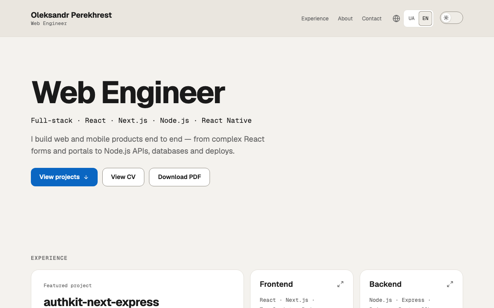
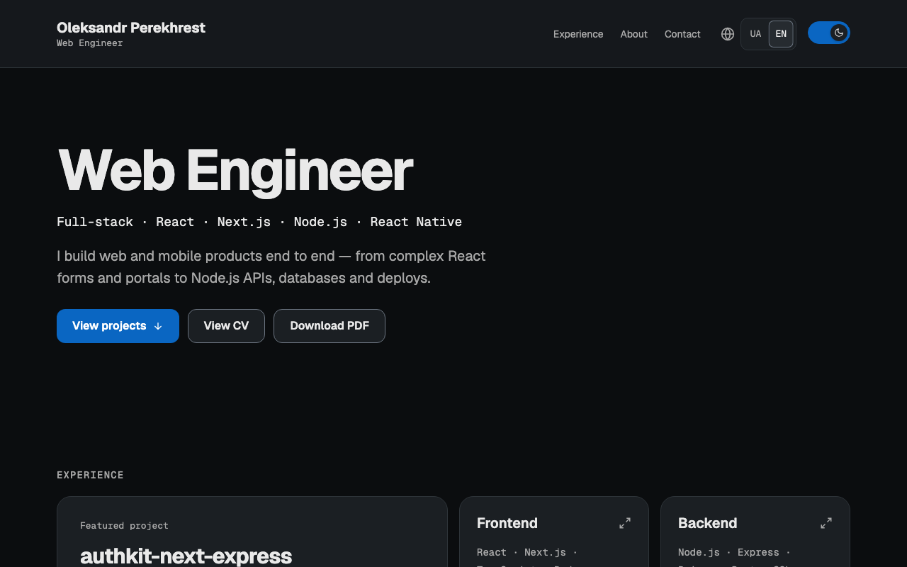
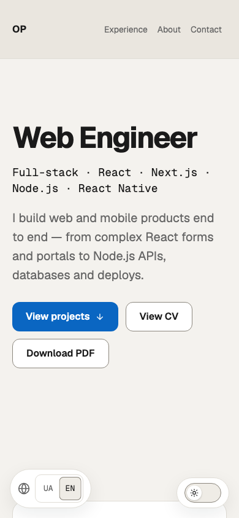

# portfolio-next

[](https://github.com/Oleksandr-Perekhrest/portfolio-next/actions/workflows/ci.yml)

Bilingual (EN/UK) personal portfolio of a Web Engineer built with Next.js App Router, statically generated and deployed to Vercel. Includes a project gallery, commercial experience, tech stack, downloadable CV, and a contact form backed by Resend.

**Live site:** https://o-perekhrest.vercel.app

## Screenshots

| Desktop — light                                      | Desktop — dark                                     | Mobile — light                                     |
| ---------------------------------------------------- | -------------------------------------------------- | -------------------------------------------------- |
|  |  |  |

## Tech stack

| Category   | Package               | Version |
| ---------- | --------------------- | ------- |
| Framework  | Next.js               | 16.4.3  |
| UI         | React                 | 19.3.0  |
| Language   | TypeScript            | ^5      |
| i18n       | next-intl             | ^4.14.9 |
| Primitives | radix-ui              | ^1.8.1  |
| Forms      | React Hook Form + zod | ^7 / ^4 |
| Email      | Resend                | ^6      |
| Styles     | Sass (SCSS Modules)   | ^1      |
| Icons      | simple-icons          | 16.35.0 |

## Features

- **Bilingual routing** — EN and UK locales with `localePrefix: "always"` and automatic locale detection; handled by `next-intl` in [src/proxy.ts](src/proxy.ts).
- **Flash-free light/dark theme** — inline `<script>` in `<head>` reads `localStorage` and falls back to `prefers-color-scheme`, setting `data-theme` before first paint ([src/lib/theme.ts](src/lib/theme.ts)).
- **SCSS design tokens** — token maps in [src/styles/_tokens.scss](src/styles/_tokens.scss) emitted as CSS custom properties; colors, typography, and spacing all come from tokens via `var(--)`, never hard-coded.
- **Radix dialogs with focus management** — CV viewer (iframe on desktop, direct link on mobile) and contact form use Radix `Dialog` with manual `onCloseAutoFocus` to return focus correctly.
- **Contact form with anti-spam** — React Hook Form + zod on the client, server action in [src/lib/contact/actions.ts](src/lib/contact/actions.ts); honeypot `website` field and a 3-second minimum fill time silently reject bots; form degrades gracefully when env vars are absent.
- **CV viewer with mobile fallback** — on tablet and wider, "View CV" opens a Radix dialog with an embedded iframe; on mobile, the same link opens the PDF in a new tab.
- **Generated OG images and icons** — per-locale OG image ([src/app/\[locale\]/opengraph-image.tsx](src/app/%5Blocale%5D/opengraph-image.tsx)) and monogram favicon ([src/app/icon.tsx](src/app/icon.tsx)) built at compile time via `ImageResponse`; no static image files.
- **Security headers** — `X-Content-Type-Options`, `Referrer-Policy`, `X-Frame-Options: SAMEORIGIN`, and `Permissions-Policy` applied to all routes in [next.config.ts](next.config.ts).

## Key decisions

- [src/proxy.ts](src/proxy.ts) instead of `middleware.ts` — Next.js 16 picks up `src/proxy.ts` by file convention; it exports `next-intl`'s `createMiddleware(routing)` directly.
- [src/app/\[locale\]/opengraph-image.tsx](src/app/%5Blocale%5D/opengraph-image.tsx) and [src/app/icon.tsx](src/app/icon.tsx) — OG image and favicon generated at build time via `ImageResponse`; no static assets to maintain.
- [src/components/experience/CommercialGallery/CommercialGallery.module.scss](src/components/experience/CommercialGallery/CommercialGallery.module.scss) — all carousel items share `grid-area: 1/1` and hidden items use `visibility: hidden` (not `display: none`), so the card height is always that of the tallest item.
- [src/content/\*.test.ts](src/content) — tests derive all expectations from content data arrays; adding a project, tech, or commercial entry automatically validates key parity without updating any test counts.
- [src/i18n/routing.ts](src/i18n/routing.ts) — `localeDetection: true` with `localePrefix: "always"` means `/en` and `/uk` are always explicit; no ambiguous root route.

## Getting started

Requires **Node 24** (see [.nvmrc](.nvmrc)).

```bash
pnpm install
cp .env.example .env.local   # fill in values (see table below)
pnpm dev                     # http://localhost:3000
```

### Environment variables

| Variable           | Description                                    |
| ------------------ | ---------------------------------------------- |
| `RESEND_API_KEY`   | Resend API key for sending contact form emails |
| `CONTACT_TO_EMAIL` | Recipient address for contact form submissions |

Both variables are optional for local development; if absent the contact form returns a degraded "unavailable" state instead of sending.

## Scripts

| Script              | Description                                                 |
| ------------------- | ----------------------------------------------------------- |
| `pnpm dev`          | Start the Next.js dev server at http://localhost:3000       |
| `pnpm build`        | Production build                                            |
| `pnpm start`        | Serve the production build                                  |
| `pnpm lint`         | ESLint across the whole project                             |
| `pnpm typecheck`    | Generate Next.js types, then run `tsc --noEmit`             |
| `pnpm format`       | Prettier write (whole project)                              |
| `pnpm format:check` | Prettier check (used in CI and pre-push)                    |
| `pnpm test`         | Jest single run                                             |
| `pnpm test:watch`   | Jest in watch mode                                          |
| `pnpm test:e2e`     | Playwright E2E tests (builds + starts prod server on :3100) |

## Testing and CI

**Unit tests** — Jest + React Testing Library, colocated as `*.test.ts(x)`. Import `describe`, `it`, `expect` explicitly from `@jest/globals` (`@types/jest` is not installed).

**E2E tests** — Playwright against a production build on port 3100. Three browser projects: `chromium`, `webkit`, `mobile-chrome`. A local mock server intercepts all Resend API calls so tests never send real emails. See [playwright.config.ts](playwright.config.ts).

**CI** (`.github/workflows/ci.yml`) runs three jobs in order:

| Job          | Steps                                                                   |
| ------------ | ----------------------------------------------------------------------- |
| `checks`     | format:check → lint → typecheck → test → build                          |
| `lighthouse` | build → Lighthouse CI (perf ≥ 0.90, a11y / best-practices / seo = 1.00) |
| `e2e`        | Playwright on chromium + webkit; report uploaded as artifact            |

**Lefthook** hooks:

- `pre-commit` — ESLint `--fix` and Prettier `--write` on staged files, then re-stages.
- `pre-push` — format:check, lint, typecheck, test, build (sequential).

## Adding content

### a. Commercial project

1. Add an entry to [src/content/commercial.ts](src/content/commercial.ts):

   ```ts
   {
     id: "myProject",   // must match a key added in step 2
     role: "frontend",  // "frontend" | "backend" | "fullstack"
     stack: ["React", "TypeScript"],
   }
   ```

2. Add the display name under `Experience.commercial.items` in both [messages/en.json](messages/en.json) and [messages/uk.json](messages/uk.json):

   ```json
   "items": { "myProject": "My project title" }
   ```

The `id` type is derived from `en.json` at compile time, so TypeScript rejects an id that has no matching key. The content test in [src/content/content.test.ts](src/content/content.test.ts) verifies key parity with `uk.json`. Card height adapts automatically because all carousel items share the same grid cell.

### b. Technology

Add an entry to [src/content/tech.ts](src/content/tech.ts):

```ts
{ name: "Vite", area: "frontend", level: 3 }
// OR, for a top-tier entry with an icon:
{ name: "Svelte", area: "frontend", level: 1, icon: siSvelte }
```

- `area`: `"frontend"` | `"backend"` | `"shared"` (shared items have no `level` or `icon`).
- `level` 1–4: lower = higher priority. The tile summary shows the top 5 by level per area.
- **Icon rule enforced by tests**: levels 1–2 in `frontend`/`backend` must have a `simple-icons` icon; levels 3–4 and all `shared` items must not. Tests in [src/content/tech.test.ts](src/content/tech.test.ts) check these invariants — no counts to update.

### c. Personal project

1. Extend the `id` union in the `Project` type in [src/content/projects.ts](src/content/projects.ts) — it is a string literal union, not derived from messages:

   ```ts
   export type Project = {
     id: "authkit" | "myRepo";
     // ...
   };
   ```

2. Add an entry to the `projects` array in the same file:

   ```ts
   {
     id: "myRepo",
     name: "my-repo-name",
     repoUrl: "https://github.com/...",
     demoUrl: "https://...",
     stack: ["Next.js", "PostgreSQL"],
   }
   ```

3. Add a description in both message files under `Experience.projects.<id>.description`.

> **Known limitation:** ProjectGallery does not use the stacked-grid layout yet, so adding a second project may change the card height when the user navigates between items.

### d. CV PDFs

1. Drop the PDF files in `public/cv/` following the naming convention already in use:
   - `CV-Perekhrest-Oleksandr-Web-Engineer-EN.pdf`
   - `CV-Perekhrest-Oleksandr-Web-Engineer-UA.pdf`

2. If you rename the files, update the paths in every place that references the current names (confirmed with `git grep`):
   - [src/content/cv.ts](src/content/cv.ts) — the path map
   - [src/components/CvActions/CvActions.test.tsx](src/components/CvActions/CvActions.test.tsx) — expected paths in unit tests
   - [e2e/cv.spec.ts](e2e/cv.spec.ts) — path and filename constants
   - [e2e/headers.spec.ts](e2e/headers.spec.ts) — `EN_PDF_PATH` constant

The test in [src/content/cv.test.ts](src/content/cv.test.ts) checks that every locale has a path and that the file exists in `public/`.

### e. General rule

Any user-facing string, `aria-label`, `alt`, `title`, or page metadata must be added to **both** [messages/en.json](messages/en.json) and [messages/uk.json](messages/uk.json). Tests must derive expected values from content data arrays — never hardcode counts that would need updating when content changes.

## Deployment

The site deploys to Vercel on every push to `main`. Preview deployments are created for every pull request.

Add these environment variables in the Vercel project settings:

| Variable           | Description                               |
| ------------------ | ----------------------------------------- |
| `RESEND_API_KEY`   | Resend API key                            |
| `CONTACT_TO_EMAIL` | Recipient address for contact form emails |

## Known limitations

- The contact form sends from Resend's shared test address `onboarding@resend.dev` because a custom sending domain is not yet configured.
- There is no rate limiting on the contact server action.
- No Content-Security-Policy header is set.
- ProjectGallery does not use the stacked-grid layout, so the card height may change when navigating between projects if more than one project is added.

## Next steps

- Register a custom domain, then configure a Resend sending domain and update `siteUrl` in [src/lib/site.ts](src/lib/site.ts).
- Add a Content-Security-Policy with nonces generated in [src/proxy.ts](src/proxy.ts).
- Apply the stacked-grid layout to ProjectGallery when a second project is added.

## Contacts

- LinkedIn: https://www.linkedin.com/in/alexandr-perekhrest-465b882b2
- GitHub: https://github.com/Oleksandr-Perekhrest
- Telegram: https://t.me/Oleksandr_Pe
